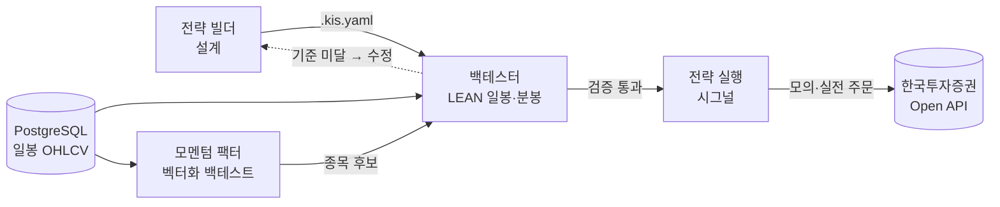

<p align="center">
  
</p>

<p align="center">
  <b>코딩 없이 전략을 설계하고, 과거 데이터로 검증하고, 바로 주문까지.</b><br>
  국내 주식 퀀트 트레이딩 플랫폼
</p>

<p align="center">
  
  
  
  
  
</p>

---

## LIMSON이 하는 일

| | 기능 | 설명 |
|---|---|---|
| 🧩 | **전략 빌더** | 지표 80종 · 프리셋 전략 10종을 조합해 진입/청산 조건과 리스크를 화면에서 설계 |
| 📈 | **백테스터** | QuantConnect LEAN 엔진으로 **일봉 · 1분봉** 백테스트, 수익률·MDD·샤프·KOSPI 비교 리포트 |
| 🧮 | **모멘텀 팩터** | 벡터화 백테스트로 유니버스 전체를 몇 초 만에 분위 분석 (Rank IC, 롱숏 스프레드, 최신 순위) |
| ⚡ | **실행** | 검증한 전략으로 BUY/SELL 시그널을 만들고 한국투자증권 Open API로 모의·실전 주문, 실시간 호가 |
| ☁️ | **배포** | 명령 하나로 EC2에 올려 한 포트(nginx)로 서비스, systemd 자동 재시작, PostgreSQL 자동 연결 |

## 워크플로우



| 전략 빌더 | 백테스터 |
|---|---|
|  |  |

## 구성

```
브라우저 ──► nginx (한 포트, Basic 인증)
              ├─ /backtest/api/*  → 백테스터 API   FastAPI :8002 ──► PostgreSQL · Docker LEAN
              ├─ /backtest*       → 백테스터 웹    Next.js :3001   (/backtest, /backtest/factor)
              ├─ /api/*           → 전략 빌더 API  FastAPI :8000 ──► 한국투자증권 Open API (REST · WebSocket)
              └─ /                → 전략 빌더 웹   Next.js :3000   (/builder, /execute)
```

| 디렉터리 | 내용 |
|---|---|
| [`strategy_builder/`](strategy_builder/README.md) | 전략 설계 UI, 시그널 엔진, 주문·계좌·실시간 호가 API |
| [`backtester/`](backtester/README.md) | LEAN 코드 생성·실행, 일봉/분봉 데이터 준비, 벡터화 팩터 엔진(`kis_backtest/vectorized`) |
| [`deploy/`](deploy/README.md) | EC2 배포 스크립트, nginx·systemd 설정, 로컬 백테스트 워커 |
| `examples_user/`, `examples_llm/` | 한국투자증권 Open API 호출 예제 (상품별 통합 / 기능 단위) |
| `MCP/` | AI 도구 연동용 MCP 서버 |

## 빠른 시작 (로컬)

**준비물**: Python 3.11+ · [uv](https://docs.astral.sh/uv/) · Node.js 20.9+ · Docker · PostgreSQL(일봉 OHLCV) · 한국투자증권 Open API 앱키

```bash
git clone https://github.com/zhanggu9/open-trading-api.git limson
cd limson

# 1) 한국투자증권 앱키·계좌 설정
vi kis_devlp.yaml        # my_app/my_sec(실전), paper_app/paper_sec(모의), 계좌번호

# 2) 일봉 DB 연결
vi backtester/.env       # DATABASE_URL=postgresql://user:pw@host:port/db

# 3) 전체 실행 (백엔드 2 + 프론트엔드 2, Ctrl+C로 종료)
./start.sh
```

- 전략 빌더: http://localhost:3000/builder
- 백테스터: http://localhost:3001/backtest · 모멘텀 팩터: http://localhost:3001/backtest/factor

<details>
<summary><code>kis_devlp.yaml</code> 항목</summary>

```yaml
my_app: "실전 앱키"
my_sec: "실전 앱시크릿"
paper_app: "모의 앱키"
paper_sec: "모의 앱시크릿"
my_htsid: "HTS ID"
my_acct_stock: "증권계좌 앞 8자리"
my_paper_stock: "모의 증권계좌 앞 8자리"
my_prod: "01"
```

토큰은 `~/KIS/config/` 에 저장됩니다. 분봉 백테스트는 실전 인증이 필요합니다.
</details>

## 서버 배포 (EC2)

로컬 PC(WSL)의 저장소 루트에서 한 줄이면 됩니다. SSH 키는 `/home/l/stock-coin-trade/` 의 `*.pem` / `*.key` 를 자동으로 찾습니다.

```bash
BACKTEST_MODE=local ./deploy/deploy.sh       # 첫 배포 (작은 서버: 백테스트는 로컬 PC에서 실행)
./deploy/local_backtest_worker.sh install    # 로컬 PC 백테스트 워커 (한 번)
```

배포가 끝나면 `http://13.209.87.155:8011` 에서 접속합니다 (로그인 ID/PW는 첫 배포 결과에 출력).
EC2 보안 그룹에 TCP 8011을 열어야 하며, 자세한 옵션·운영 명령은 [deploy/README.md](deploy/README.md)에 있습니다.

## 기능 상세

### 전략 빌더 → 백테스터 → 실행
1. **설계** — 지표·조건·리스크(손절/익절/트레일링)를 조합하고 `.kis.yaml`로 내보냅니다.
2. **검증** — 백테스터에 불러와 기간·종목·비용을 정하고 LEAN으로 실행합니다. 봉 단위는 일봉(PostgreSQL) 또는 1분봉(KIS 주식일별분봉조회, 최근 1년 · 최대 92일)을 고릅니다.
3. **실행** — 검증된 전략을 빌더로 다시 불러와 실시간 시그널을 보고 주문 확인 후 모의/실전 주문을 냅니다.

### 모멘텀 팩터 (벡터화 백테스트)
- 12-1개월 모멘텀으로 유니버스를 n분위로 나누고 월말/주말 리밸런싱합니다.
- 다음 거래일 체결, 리밸런싱 사이 비중 변동, 회전율 기반 거래비용(수수료·거래세·슬리피지)을 반영합니다.
- 분위별 성과, 롱숏 스프레드, Rank IC(평균·IR·t-통계량), 최신 상·하위 종목을 보여줍니다.

### 프리셋 전략 10종
골든크로스 · 모멘텀 · 52주 신고가 · 연속 상승/하락 · 이격도 · 돌파 실패 · 강한 종가 · 변동성 확장 · 평균회귀 · 추세 필터

## 개발

```bash
cd backtester && uv run pytest -q                 # 백테스터 테스트
cd backtester/frontend && npx tsc --noEmit        # 프론트엔드 타입 검사
```

## 주의

- 투자 판단과 그 결과의 책임은 사용자에게 있습니다. 백테스트 성과는 미래 수익을 보장하지 않습니다.
- `kis_devlp.yaml`, `backtester/.env` 에는 앱키·DB 비밀번호가 들어가므로 공개 저장소에 올리지 마세요.
- 실전 주문 전에 반드시 모의투자로 충분히 확인하세요.

---

<p align="center">Made by <b>LIMSON</b> · 한국투자증권 Open API 기반</p>
